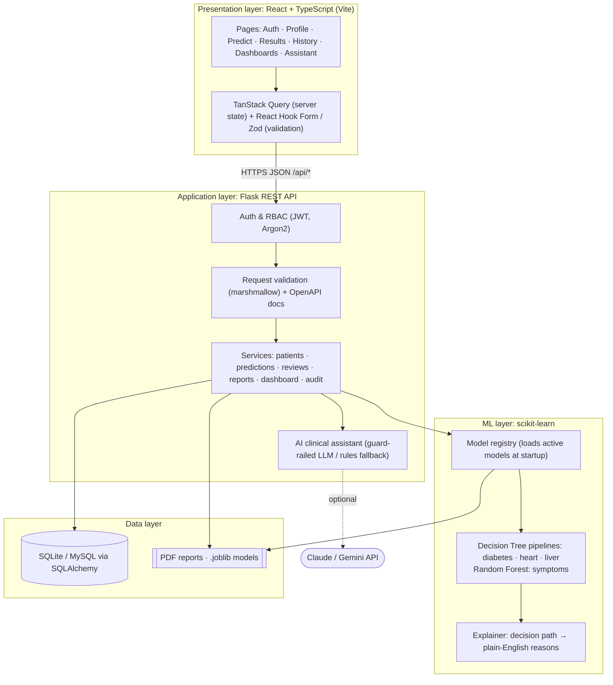
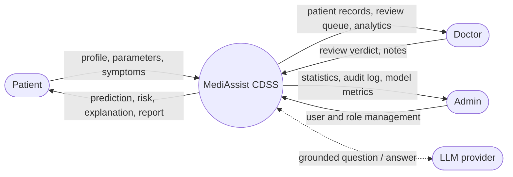
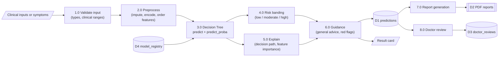
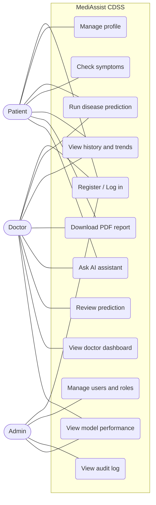
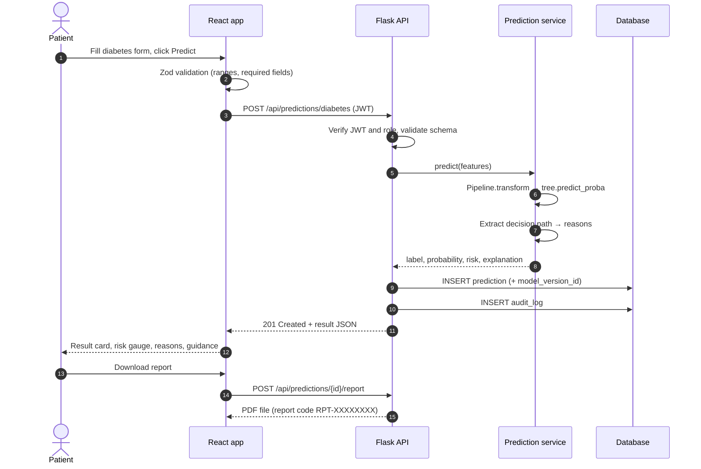

# 2. System Architecture

> Diagrams are written in [Mermaid](https://mermaid.js.org) and render automatically on GitHub and
> in VS Code (Markdown Preview Mermaid Support extension). Export them to PNG for the final report
> with <https://mermaid.live>.

## 2.1 Layered architecture



## 2.2 Data-flow diagram: Level 0 (context)



## 2.3 Data-flow diagram: Level 1 (prediction)



## 2.4 Use-case diagram



## 2.5 Sequence: running a prediction



## 2.6 Main user workflows

**Patient:** Register / Login → Complete profile → Choose module → Enter parameters or symptoms →
Result (probability, risk, reasons) → Guidance → Saved to history → Download report →
(Optional) Ask assistant → See the doctor's review when available.

**Doctor:** Login → Dashboard (pending reviews, risk distribution) → Open patient →
Inspect prediction and explanation → Record verdict and notes → Patient is notified on their history page.

**Admin:** Login → Dashboard (users, predictions over time) → Manage users / assign doctors →
Audit log → Model performance.

## 2.7 Repository layout

```
Healthcare Diagnosis/
├── frontend/          React + TypeScript (Vite, Tailwind CSS)
├── backend/           Flask API (app factory, SQLAlchemy models, Alembic migrations, pytest)
├── ml/                Datasets, notebooks, training pipeline, trained models and model cards
├── docs/              Requirements, architecture, database, datasets, API design
└── .github/workflows/ Continuous integration
```

## 2.8 Technology choices

| Concern | Choice | Reason |
|---|---|---|
| Frontend | React 19 + TypeScript + Vite | Type safety catches bugs early; Vite gives instant reloads |
| Styling | Tailwind CSS 4 | Consistent design tokens, fast to build responsive layouts |
| Server state | TanStack Query | Caching, loading and error states without hand-written boilerplate |
| Forms | React Hook Form + Zod | The same validation rules give instant feedback in the browser |
| Charts | Recharts | Declarative React charts for dashboards and metrics |
| API | Flask 3 + flask-smorest | Lightweight; generates OpenAPI / Swagger documentation from schemas |
| ORM / migrations | SQLAlchemy 2 + Alembic | One code base for SQLite and MySQL; versioned schema changes |
| Auth | Flask-JWT-Extended + Argon2id | Stateless tokens for a SPA; Argon2 is the recommended modern password hash |
| ML | scikit-learn Decision Tree in a `Pipeline` (Random Forest for the symptom module) | Interpretable by design; preprocessing and model saved together. See [06-model-evaluation.md](06-model-evaluation.md) for the symptom-module rationale |
| Reports | ReportLab | Pure-Python PDF generation that works on Windows without extra system libraries |
| Testing | pytest, Vitest, React Testing Library, Playwright | Unit, integration and end-to-end coverage |
| CI | GitHub Actions | Lint, type-check and test on every push |
