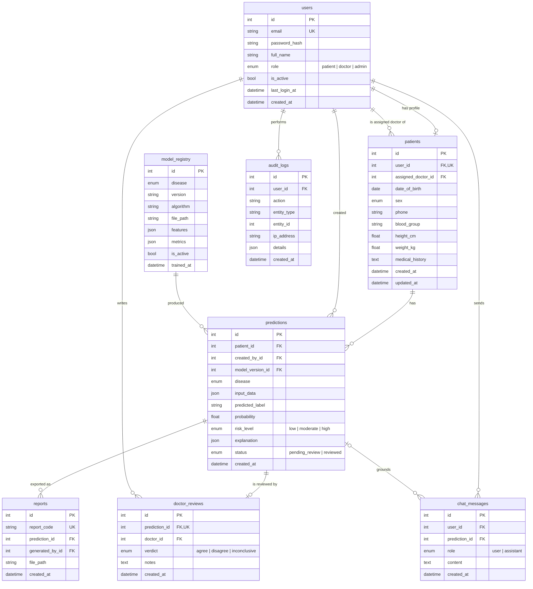

# 3. Database Design

The schema is defined by SQLAlchemy models in [`backend/app/models/`](../backend/app/models) and
versioned with Alembic migrations in [`backend/migrations/`](../backend/migrations). Enum columns
are stored as `VARCHAR` with a `CHECK` constraint so the schema behaves the same on SQLite and MySQL.

## 3.1 Entity-relationship diagram

## 3.2 Table descriptions

| Table | Purpose | Notable design decisions |
|---|---|---|
| `users` | One login account per person | Single table plus a `role` column (simple RBAC); `email` unique and indexed; Argon2id hash only, never the password |
| `patients` | Demographic and baseline profile | 1-to-1 with a patient user; `assigned_doctor_id` links to a doctor user; age and BMI are **derived**, not stored |
| `model_registry` | Every trained model version | `UNIQUE(disease, version)`; one `is_active` model per disease; metrics stored as JSON for the model performance page |
| `predictions` | One model run | Inputs stored as JSON because each disease has different features; links to `model_registry` for traceability |
| `doctor_reviews` | Human-in-the-loop verdict | `UNIQUE(prediction_id)`, so at most one review per prediction; saving a review sets `predictions.status = reviewed` |
| `reports` | Generated PDFs | `report_code` is a random public identifier (e.g. `RPT-7F3K9Q2M`) printed on the PDF, so internal IDs are not exposed |
| `audit_logs` | Security and accountability trail | Kept even if the user is deleted (`ON DELETE SET NULL`) |
| `chat_messages` | AI assistant conversation history | Optionally grounded in one prediction |

## 3.3 Normalisation

The schema is in **third normal form**: every non-key attribute depends only on its table's
primary key. The one deliberate exception is `predictions.input_data` (JSON). It is a snapshot of
exactly what the model saw at that moment, so it must not change if the patient's profile is
edited later. This is an audit requirement, not redundancy.

## 3.4 Referential actions

| Relationship | On delete |
|---|---|
| User → patient profile | `CASCADE` (deleting an account deletes its profile) |
| Patient → predictions → reviews / reports | `CASCADE` |
| Doctor / creator / model → prediction, review, report | `SET NULL` (keeps clinical history intact) |
| User → audit log | `SET NULL` (audit trail is never lost) |
