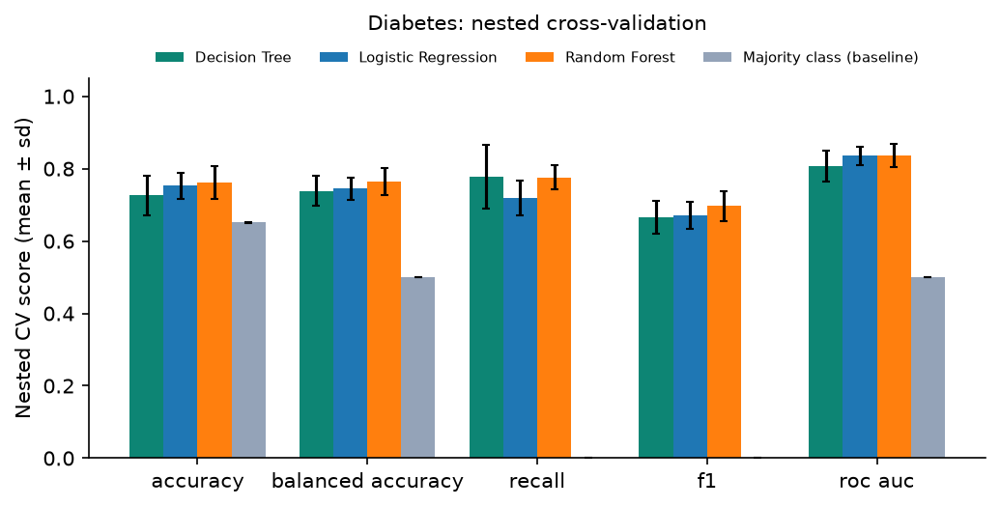
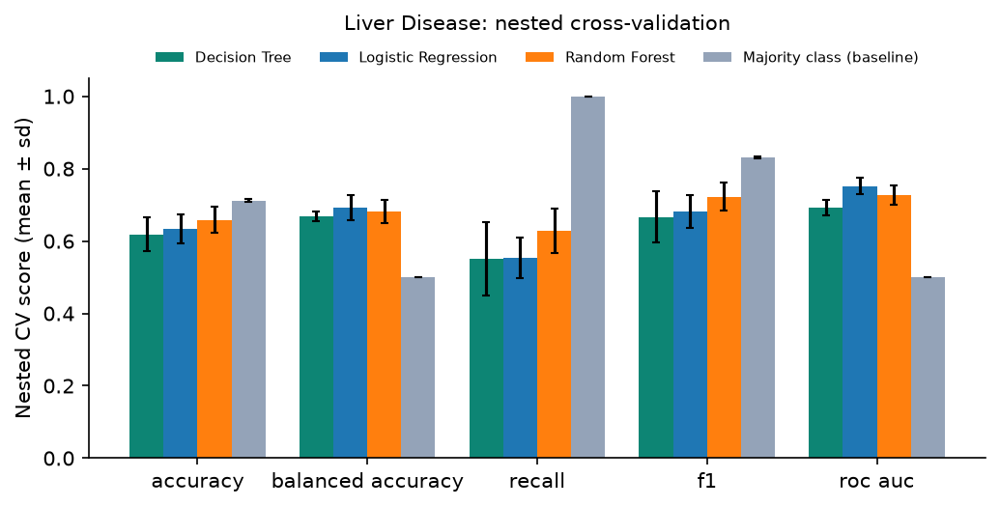
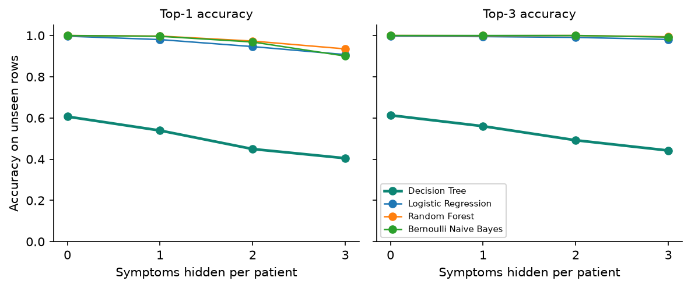

# 6. Model Development and Evaluation

The numbers below come from `python -m medml.train` (fixed seed 42). The full generated tables are in
[`ml/reports/summary.md`](../ml/reports/summary.md), every model's details are in its model card
(`ml/models/<disease>.card.json`), and the figures are in `ml/reports/<disease>/`.

## 6.1 Method

| Step | What we did | Why |
|---|---|---|
| Cleaning | Hidden zeros → missing (diabetes), duplicates removed (liver, symptoms), labels remapped, typos fixed | See [04-datasets.md](04-datasets.md). Leaving these in inflates scores or teaches the model nonsense |
| Split | 80 % train / 20 % test, stratified, seed 42 | The test set is never seen during tuning |
| Pipeline | Imputation + one-hot encoding + classifier in one scikit-learn `Pipeline` | Imputation statistics are learned only from training folds (no leakage), and the saved model accepts raw input |
| Tuning | `GridSearchCV`, 5-fold stratified, 336 Decision Tree configurations (depth, min leaf size, gini/entropy, cost-complexity pruning α, class weights) | Systematic, reproducible hyperparameter choice |
| Selection metric | **Balanced accuracy** (binary), macro F1 (symptoms) | A trivial model always scores 0.5 balanced accuracy. F1 can be gamed: on the liver data "always predict disease" already reaches F1 = 0.83 (see §6.4) |
| Parsimony | **One-standard-error rule** (Breiman et al., 1984): choose the simplest tree within 1 SE of the best CV score | Shallower trees generalise better and give shorter explanations. The heart model has only 8 leaves |
| Comparison | **Nested cross-validation** (5 outer × 2 repeats, tuning repeated inside each outer fold) against Logistic Regression, Random Forest and a majority-class baseline | An unbiased estimate: the scoring fold never influences the hyperparameters |

## 6.2 Deployed models: hold-out test set

| Module | Algorithm | Size | Accuracy | Balanced acc. | Recall (sensitivity) | Specificity | F1 | ROC AUC |
|---|---|---|---|---|---|---|---|---|
| Diabetes | Decision Tree | depth 5, 19 leaves | 0.747 | 0.720 | 0.630 | 0.810 | 0.635 | 0.799 |
| Heart disease | Decision Tree | depth 3, 8 leaves | 0.869 | 0.868 | 0.857 | 0.879 | 0.857 | 0.871 |
| Liver disease | Decision Tree | depth 4, 11 leaves | 0.684 | 0.706 | 0.654 | 0.758 | 0.747 | 0.740 |
| Symptom checker | Random Forest (200 trees) | 41 classes | 1.000 | – | – | – | 1.000 (macro) | – |

Test sets are small (61–154 rows), so one wrong prediction moves accuracy by 0.6–1.6 points.
**The nested-CV results below are the more reliable estimate** and are the ones to quote.

## 6.3 Algorithm comparison: nested cross-validation (mean ± sd)

| Module | Decision Tree | Logistic Regression | Random Forest | Majority baseline |
|---|---|---|---|---|
| Diabetes (balanced acc.) | 0.738 ± 0.042 | 0.745 ± 0.031 | 0.766 ± 0.037 | 0.500 |
| Diabetes (recall) | **0.778 ± 0.088** | 0.720 ± 0.048 | 0.776 ± 0.034 | 0.000 |
| Heart (balanced acc.) | 0.789 ± 0.058 | 0.831 ± 0.035 | 0.831 ± 0.039 | 0.500 |
| Heart (ROC AUC) | 0.831 ± 0.045 | 0.909 ± 0.033 | 0.914 ± 0.025 | 0.500 |
| Liver (balanced acc.) | 0.668 ± 0.014 | 0.693 ± 0.035 | 0.682 ± 0.033 | 0.500 |
| Liver (ROC AUC) | 0.692 ± 0.021 | 0.752 ± 0.024 | 0.728 ± 0.026 | 0.500 |
| Symptoms (macro F1) | 0.524 ± 0.047 | 0.994 ± 0.013 | **1.000 ± 0.000** | 0.002 |



### Interpretation

- **On the clinical datasets the Decision Tree is within a few points of the black-box models**
  (diabetes −2.8, heart −4.2, liver −2.5 balanced-accuracy points against the best), and every gap
  is within one standard deviation. In exchange, every prediction comes with an exact,
  human-readable explanation, and a clinician can audit the whole model on one page (see the
  [heart tree](../ml/reports/heart/tree.png)). For decision support, that trade-off is deliberate.
- **For diabetes screening, the tree ties Random Forest for the highest recall (0.78)** and beats
  Logistic Regression (0.72), so it misses the fewest diabetic patients, which is the costliest
  error in screening.
- **Liver disease is genuinely hard**: all models stay below 0.70 balanced accuracy. This agrees
  with published work on ILPD and is stated in the model card's limitations.

## 6.4 Why accuracy and F1 alone would mislead

On the liver data the majority-class baseline, which predicts "liver disease" for everyone, scores
**0.712 accuracy and 0.832 F1**, *higher than every real model*. Its balanced accuracy and ROC AUC
are 0.500, which exposes it as useless. This is why models are selected on balanced accuracy and
the baseline is always shown alongside them.



## 6.5 Symptom checker: why it uses a Random Forest

A single Decision Tree reached only **0.61 top-1 accuracy** on unseen symptom patterns. With 131
sparse yes/no symptoms and 5–10 examples per disease, one tree keys on single symptoms that a new
patient may not report. A Random Forest (an ensemble of 200 decision trees, so still decision-tree
based) generalises far better. To test this, we hid 1–3 of each test patient's symptoms, simulating
incomplete reporting:

| Algorithm | 0 hidden | 1 hidden | 2 hidden | 3 hidden |
|---|---|---|---|---|
| Decision Tree (top-1 / top-3) | 0.61 / 0.61 | 0.54 / 0.56 | 0.45 / 0.49 | 0.40 / 0.44 |
| Logistic Regression | 1.00 / 1.00 | 0.98 / 0.99 | 0.95 / 0.99 | 0.91 / 0.98 |
| **Random Forest (deployed)** | 1.00 / 1.00 | 1.00 / 1.00 | 0.97 / 1.00 | **0.94 / 0.99** |
| Bernoulli Naive Bayes | 1.00 / 1.00 | 1.00 / 1.00 | 0.97 / 1.00 | 0.90 / 0.99 |



Near-perfect scores here reflect how template-like this dataset is (only 305 unique patterns), not
real-world diagnostic accuracy. That limitation is stated in the model card and the UI.

## 6.6 Explainability

Every prediction is explained by following the patient's path through the tree. Each change in
predicted probability is credited to the feature tested at that split, so the contributions add up
**exactly** to the prediction:

```
prediction = base rate + Σ feature contributions
```

For the Random Forest the same is done for each of the 200 trees and averaged. Because the forest's
prediction is the average of its trees, the identity still holds. Both cases are verified by
automated tests (`ml/tests/test_explain.py`). Real outputs from the deployed models:

```text
Heart disease, probability 0.98 (high risk); base rate 0.50
  +0.293  Thalassemia (thallium stress test) is not normal
  +0.112  Chest pain type is asymptomatic
  +0.081  ST depression induced by exercise is 2.5 mm, above 0.45 mm

Liver disease, probability 0.85 (high risk); base rate 0.50
  +0.363  Direct bilirubin is 1.6 mg/dL, above 0.95 mg/dL
  -0.184  Age is 45 years, between 34.5 and 50.5 years
  +0.170  Total proteins is 6.4 g/dL, above 6.15 g/dL

Symptoms: itching, skin rash, nodal skin eruptions
  Fungal infection 0.51 · Drug reaction 0.23 · Acne 0.09
  +0.186  Nodal skin eruptions: present
  +0.113  Itching: present
  -0.092  Dischromic patches: absent
```

The base rate is 0.50 because the selected trees use balanced class weights. Missing optional
inputs (e.g. insulin) are filled with the training median and flagged in the explanation as
"not provided; typical value assumed".

## 6.7 Risk bands

| Probability of disease | Risk band shown |
|---|---|
| < 0.35 | Low |
| 0.35 – 0.65 | Moderate |
| ≥ 0.65 | High |

The predicted label uses a 0.5 threshold. Every result is marked "pending review" until a doctor
reviews it (Phase 3).

## 6.8 Reproducing the results

```bash
python ml/scripts/download_data.py   # verified datasets
pip install -e ml
python -m medml.train                # ~7 minutes on a laptop; rewrites models, cards and figures
pytest ml/tests                      # 28 tests: data cleaning, explainer exactness, inference
```
